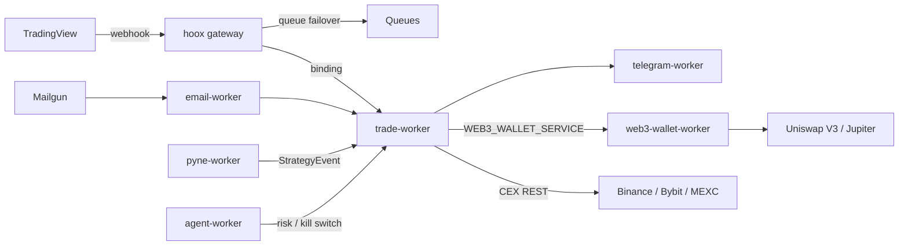

<!--
  Copyright (c) 2026 HOOX · jango-blockchained (hoox-sh)
  SPDX-License-Identifier: CC-BY-4.0
-->

# HOOX

An open-core, edge-native algorithmic trading mesh on [Cloudflare® Workers](https://workers.cloudflare.com/).

HOOX ingests trade signals (webhooks, email, Telegram, PYNE strategy events), validates them, applies risk policy, and routes CEX REST and DEX spot hops from V8 isolates colocated with exchange APIs. Eleven compute surfaces (ten Workers plus an OpenNext dashboard) talk over Cloudflare Service Bindings: isolate-to-isolate RPC with no public-internet traversal, TLS handshake, or DNS lookup between components.

On the direct path, median webhook-to-exchange acknowledgment was **22 ms** (N = 16,104 terminal acks, July 2025–July 2026). Queued signals reached a 99.97% terminal success rate within five minutes across 14 exchange-maintenance windows. Measurement and method: [`papers/hoox-arxiv-paper-core.pdf`](papers/hoox-arxiv-paper-core.pdf).

<div align="center">


[](https://github.com/hoox-sh/hoox)
[](https://github.com/hoox-sh/pyne)
[](https://github.com/hoox-sh/axis)
[](https://github.com/hoox-sh/hoox/actions/workflows/ci.yml)
[](https://codecov.io/gh/hoox-sh/hoox)
[](https://www.typescriptlang.org/)
[](https://bun.sh)
[](https://workers.cloudflare.com/)
[](https://www.npmjs.com/package/@hoox-sh/hoox-cli)
[](LICENSE-CODE)

[hoox.sh](https://hoox.sh) · [docs.hoox.sh](https://docs.hoox.sh) · [install](https://hoox.sh/install) · [CHANGELOG](CHANGELOG.md) · [paper](papers/hoox-arxiv-paper-core.pdf)

</div>

HOOX is the **execution mesh**. [PYNE](https://github.com/hoox-sh/pyne) evaluates Pine Script™; [AXIS](https://github.com/hoox-sh/axis) is the charting PWA. All three publish under [hoox.sh](https://hoox.sh).

---

## Architecture

Only the gateway and dashboard accept public HTTP. Remaining isolates are reachable via Service Bindings (plus tooling auth such as pyne-worker `API_KEY`). Worker trees are git submodules; isolate profiles live under [docs → Workers](https://docs.hoox.sh/docs/devops/workers).

| Isolate              | Role                                                                                           | Tree                                                                |
| -------------------- | ---------------------------------------------------------------------------------------------- | ------------------------------------------------------------------- |
| `hoox` (gateway)     | Webhook ingress, WAF / IP allowlist, rate limits, Durable Object idempotency, dispatch         | [hoox-worker](https://github.com/hoox-sh/hoox-worker)               |
| `trade-worker`       | CEX (Binance / Bybit / MEXC) and DEX spots (Uniswap V3 / Jupiter) via wallet binding           | [trade-worker](https://github.com/hoox-sh/trade-worker)             |
| `agent-worker`       | AI risk manager — cron (1–1440 min), trailing stops, kill switch                               | [agent-worker](https://github.com/hoox-sh/agent-worker)             |
| `d1-worker`          | D1 SQL proxy (table allowlist), settings KV, balances and positions                            | [d1-worker](https://github.com/hoox-sh/d1-worker)                   |
| `telegram-worker`    | Notification plane — alerts, bot commands, RAG copilot                                         | [telegram-worker](https://github.com/hoox-sh/telegram-worker)       |
| `email-worker`       | Mailgun / mailbox parse → trade-worker                                                         | [email-worker](https://github.com/hoox-sh/email-worker)             |
| `analytics-worker`   | Analytics Engine fan-in (trades, signals, latency, heartbeats)                                 | [analytics-worker](https://github.com/hoox-sh/analytics-worker)     |
| `report-worker`      | Browser Rendering PDFs → R2, Telegram delivery                                                 | [report-worker](https://github.com/hoox-sh/report-worker)           |
| `web3-wallet-worker` | On-chain signing — Uniswap V3 (Ethereum / Arbitrum), Jupiter Swap V2 (Solana)                  | [web3-wallet-worker](https://github.com/hoox-sh/web3-wallet-worker) |
| `pyne-worker`        | Python PYNE `POST /run`, bar-close cron, R2 OHLCV; live strategy → trade-worker needs mesh key | [pyne-worker](https://github.com/hoox-sh/pyne-worker)               |
| `dashboard`          | Next.js ops console (OpenNext on Workers; in-tree)                                             | [workers/dashboard](workers/dashboard)                              |



Kill-switch keys are `trade:kill_switch` and `global:kill_switch` (`hoox monitor kill-switch`). Operator management can sit behind Cloudflare Access / tunnel (`hoox doctor --security`, `hoox tunnel check`).

---

## Operator surfaces

Four faces of the same mesh: CLI for automation and CI, TUI for a terminal ops center, dashboard for visual risk, MCP for agents.

<p align="center">
  
</p>

| Surface       | Entry                    | Notes                                                                                         |
| ------------- | ------------------------ | --------------------------------------------------------------------------------------------- |
| **CLI**       | `hoox` / `hx`            | Bun bundle. Bare `hoox` opens the interactive menu once `wrangler.jsonc` exists.              |
| **TUI**       | `hoox tui`               | OpenTUI. Settings `defaultView` and `refreshIntervalMs` drive session restore and pollers.    |
| **Dashboard** | `hoox deploy dashboard`  | OpenNext on Workers (`https://<subdomain>.workers.dev`). Needs gateway, D1, and agent-worker. |
| **MCP**       | `bun run mcp` (checkout) | Private stdio server in `packages/mcp` — one tool per CLI command, confirm gate, redaction.   |

Gallery: [docs.hoox.sh → screenshots](https://docs.hoox.sh/docs/enduser/guides/screenshots) · [`docs/images/`](docs/images/).

### CLI

| Group     | Commands                                                                  |
| --------- | ------------------------------------------------------------------------- |
| Bootstrap | `onboard`, `init`, `setup`, `clone --all`                                 |
| Mesh      | `deploy all --auto`, `dev start`, `infra`, `workers`, `waf`               |
| Secrets   | `config`, `secrets`, `keys`, `db`                                         |
| Observe   | `check health`, `monitor`, `logs`, `perf fastpath`, `trace`, `agent`      |
| Operator  | `doctor`, `repair`, `tunnel check`, `pyne`, `tui`, `update`, `completion` |

`--json` emits machine documents (no spinner ANSI). `--quiet` is silent. Full tree: [CLI reference](https://docs.hoox.sh/docs/enduser/reference/cli-commands) · [packages/cli/README.md](packages/cli/README.md).

MCP: mutating tools return a `confirm_token`; secrets go on stdin and are redacted in results. See [docs → MCP](https://docs.hoox.sh/docs/devops/mcp).

---

## Install

The CLI is a Bun bundle (`bun add -g @hoox-sh/hoox-cli`). Global `npm` install fails: the tarball still carries `optionalDependencies["@hoox-sh/hoox-tui"] = "workspace:*"`.

```bash
curl -fsSL https://bun.sh/install | bash   # Bun ≥ 1.2
bun add -g @hoox-sh/hoox-cli
git clone --recursive https://github.com/hoox-sh/hoox.git
cd hoox
hoox onboard
hoox deploy all --auto
hoox check health
```

`hoox onboard` writes `wrangler.jsonc`, collects integration secrets, generates mesh keys, applies the D1 schema, pushes Worker secrets, and deploys the dashboard. Split path: `hoox init` then `hoox setup`. Non-interactive: `hoox onboard --token cfut_xxx --account xxx --preset full`.

After first discovery the CLI remembers the monorepo (`HOOX_REPO` → walk-up from cwd → `~/.hoox/config/monorepo.json` → `~/.hoox/repo`) and `chdir`s, so `hx` works from any directory.

| Prerequisite           | Notes                                          |
| ---------------------- | ---------------------------------------------- |
| **Bun ≥ 1.2**          | Required runtime for CLI, TUI, and unit tests. |
| **Cloudflare account** | Free tier covers typical retail volume.        |
| **Git**                | Workspace plus worker submodules.              |
| **Docker + Compose**   | Optional — local mesh or self-hosted gateway.  |

**Clone without `--recursive`:** `git submodule update --init --recursive` or `hoox clone --all`.

**Docker (Service Binding topology mirrored locally).** Only the gateway and dashboard bind host ports.

```bash
docker compose --profile workers up       # workers
docker compose --profile dashboard up     # dashboard + deps  → :8794
docker compose --profile full up          # full stack
# hoox dev start --runtime docker
```

Gateway: `http://localhost:8787`. Dashboard (compose): `http://localhost:8794`. Native dashboard: `hoox dev dashboard` → `localhost:3000`.

**Self-hosted image.** Demos, air-gap, or local HTTP. Durable Objects, Vectorize, and Workers AI are Cloudflare-only.

```bash
bun run docker:prod
# docker run -p 8080:8080 -e HOOX_SERVER_API_KEY=your-key hoox:prod
```

**Production deploy** after onboard:

```bash
hoox deploy all --auto
hoox deploy telegram-webhook
hoox deploy update-internal-urls
hoox deploy kv-config
hoox check health
```

Guides: [Installation](https://docs.hoox.sh/docs/enduser/getting-started/installation) · [Operations](https://docs.hoox.sh/docs/devops/setup-and-operations).

| Package                 | Version | Registry |
| ----------------------- | ------- | -------- |
| `@hoox-sh/hoox-cli`     | 0.16.0  | npm      |
| `@hoox-sh/hoox-tui`     | 0.4.0   | npm      |
| `@hoox-sh/hoox-shared`  | 1.6.0   | npm      |
| workspace root (`hoox`) | 0.16.0  | private  |

GitHub Releases use the matching [`CHANGELOG.md`](CHANGELOG.md) section.

---

## Ecosystem

```
                    https://hoox.sh
           ┌──────────────┼──────────────┐
           ▼              ▼              ▼
         HOOX            PYNE           AXIS
    (edge execution)  (Pine engine)  (charting UI)
```

| Product  | Role                                                         | Docs                                           |
| -------- | ------------------------------------------------------------ | ---------------------------------------------- |
| **HOOX** | Signal in → risk → CEX / DEX hop → notify (this repo)        | [docs.hoox.sh](https://docs.hoox.sh)           |
| **PYNE** | Pine Script™ grammar, AST, dual-engine runtime, LSP, Pro API | [hoox.sh/pyne/docs](https://hoox.sh/pyne/docs) |
| **AXIS** | Installable charting PWA (Solid + Vite; offline via Pyodide) | [hoox.sh/axis/docs](https://hoox.sh/axis/docs) |

Satellites: [PyneTS](https://github.com/hoox-sh/pynets) (`@hoox-sh/pynets`), [pyne-worker](https://github.com/hoox-sh/pyne-worker) (in this mesh), [pyne-agent-worker](https://github.com/hoox-sh/pyne-agent-worker), [pyne-lsp / pyne-vscode](https://github.com/hoox-sh/pyne), [axis-plugin-boilerplate](https://github.com/hoox-sh/axis-plugin-boilerplate). Conceptual split: [Ecosystem](https://docs.hoox.sh/docs/enduser/concepts/ecosystem).

The marketing site [hoox.sh](https://hoox.sh) is a private Next.js tree.

---

## Documentation

|              |                                                                                 |
| ------------ | ------------------------------------------------------------------------------- |
| Product docs | [docs.hoox.sh](https://docs.hoox.sh)                                            |
| Quick start  | [5-minute guide](https://docs.hoox.sh/docs/enduser/getting-started/quick-start) |
| DEX spots    | [Uniswap / Jupiter](https://docs.hoox.sh/docs/enduser/guides/dex-spot-swaps)    |
| PYNE → live  | [Strategy events](https://docs.hoox.sh/docs/enduser/guides/pyne-live-trading)   |
| MCP          | [Agent CLI](https://docs.hoox.sh/docs/devops/mcp)                               |
| Paper        | [`papers/hoox-arxiv-paper-core.pdf`](papers/hoox-arxiv-paper-core.pdf)          |
| Changelog    | [`CHANGELOG.md`](CHANGELOG.md)                                                  |
| Contributing | [`CONTRIBUTING.md`](CONTRIBUTING.md)                                            |
| Brand        | [`brand/`](brand/)                                                              |

---

## License

Open core: **Apache-2.0** (software, [LICENSE-CODE](LICENSE-CODE)) · **CC BY 4.0** (docs and papers, [LICENSE](LICENSE)). Copyright © 2026 HOOX · jango-blockchained (hoox-sh).

Educational and research use. Trading involves substantial risk of loss. This is not financial advice. See [DISCLAIMER.md](DISCLAIMER.md).

_Pine Script™_ and _TradingView®_ are trademarks of [TradingView, Inc.](https://www.tradingview.com/); _Cloudflare®_ is a trademark of Cloudflare, Inc. HOOX is independent and is not affiliated with, authorized by, sponsored by, or endorsed by either company.
