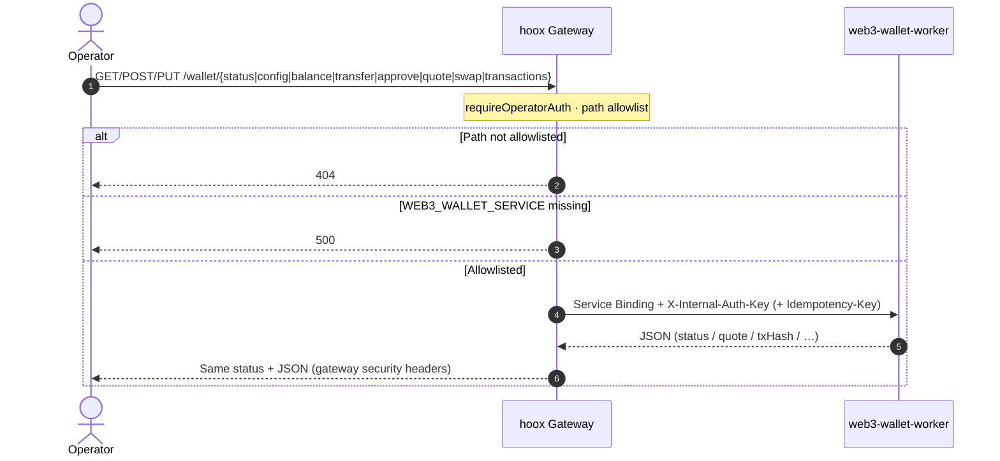
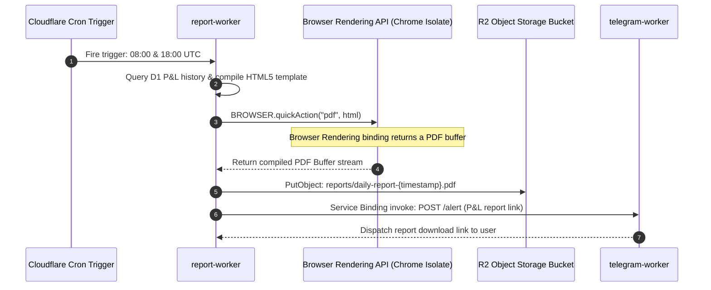
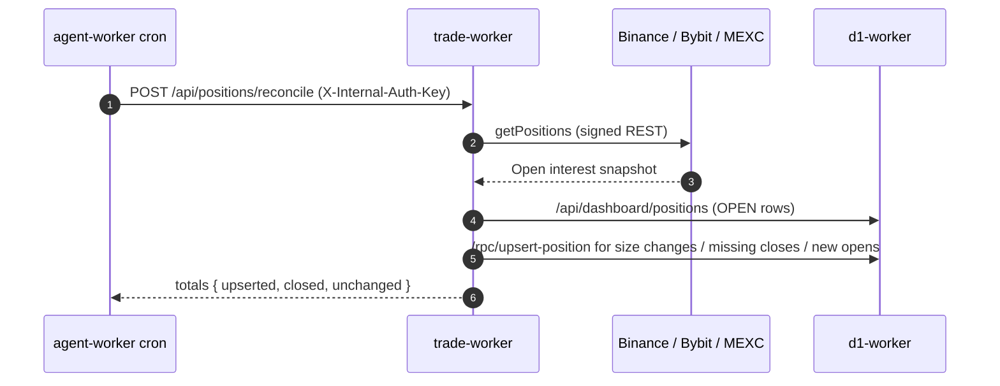
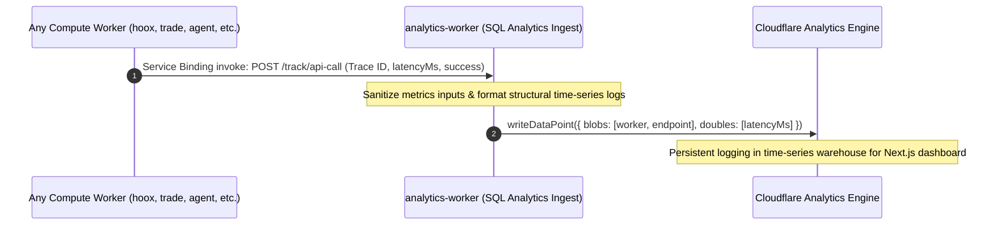

<!--
  Copyright (c) 2026 HOOX · jango-blockchained (hoox-sh)
  SPDX-License-Identifier: CC-BY-4.0
-->

---
title: "🌊 System Data Routing Spec"
description: "Comprehensive data routing, transaction sequence diagrams, time-series metrics pipelines, and global storage mapping."
---

Hoox operates as a highly orchestrated **distributed event loop**. Because execution logic is split into isolated compute nodes, data flows recursively through multiple V8 transitions, asynchronous queues, time-series datasets, and database ledgers.

This document covers the primary pipelines: webhook trade execution (CEX and spot DEX), operator wallet proxy, AI risk management, PDF rendering, observability, and Pine strategy bar-close → trade-worker.

---

## 1. Webhook to Trade Execution Flow (High-Speed Path)

This is the primary transaction pipeline. When a trade signal is received, the system validates the payload, locks the trace ID, executes the order at the edge closest to the exchange, records the fill, and alerts the user.

```mermaid
sequenceDiagram
    autonumber
    actor TV as Signal Source (TradingView®)
    participant GW as hoox Gateway
    participant RL as RateLimiterStore
    participant DO as IdempotencyStore (reserve/commit/release)
    participant TW as trade-worker
    participant D1 as d1-worker (named RPCs)
    participant TG as telegram-worker
    participant AE as analytics-worker

    TV->>GW: POST /webhook (JSON + apiKey)
    Note over GW: Kill switch · IP allowlist · 64 KiB · timing-safe apiKey
    GW->>RL: checkAndIncrement (atomic DO; KV/memory fallback)
    alt Rate limited
        GW-->>TV: 429 RATE_LIMITED
    else Under limit
        GW->>DO: reserve(idempotencyKey) → pending
        alt Duplicate or in-flight
            DO-->>GW: ok=false
            GW-->>TV: 409 Conflict
        else New reservation
            GW->>TW: Service Binding POST /webhook (X-Internal-Auth-Key)
            Note over TW: CEX HMAC REST, or DEX via WEB3_WALLET_SERVICE POST /swap
            TW->>TW: Place CEX order or wallet swap
            TW->>D1: /rpc/insert-trade · /rpc/upsert-position (safeWaitUntil)
            TW->>TG: POST /webhook or /process (chatId allowlist)
            TW->>AE: /track/* via safeWaitUntil
            TW-->>GW: trade result JSON
            alt success=true
                GW->>DO: commit(key)
                GW-->>TV: 200 OK
            else success=false or transport error
                GW->>DO: release(key)
                Note over GW: Failed attempt free to retry
            end
        end
    end
```

Spot DEX venues (`uniswap-ethereum`, `uniswap-arbitrum`, `jupiter-solana`) take the same webhook body (`exchange` + `LONG`/`SHORT`/`CLOSE_*` + `BASE/QUOTE`). **trade-worker** does not sign on-chain; it calls **web3-wallet-worker** `POST /swap` over `WEB3_WALLET_SERVICE`. Perps are not supported. `"test": true` is rejected on DEX venues (`TEST_TRADING_UNSUPPORTED`).

---

## 1b. Operator wallet proxy (`/wallet/*`)

The gateway does **not** expose web3-wallet-worker on the public internet. Operators call allowlisted `/wallet/*` paths with Bearer `OPERATOR_API_KEY`. The gateway injects mesh `X-Internal-Auth-Key` (`WALLET_EXECUTE_KEY_BINDING` preferred) and forwards `Idempotency-Key`.



Allowlisted upstream paths: `/`, `/status`, `/config`, `/balance`, `/transfer`, `/approve`, `/quote`, `/swap`, `/transactions`. See [hoox gateway](/docs/devops/workers/hoox) and [web3-wallet-worker](/docs/devops/workers/web3-wallet-worker).

---

## 2. Autonomous AI Risk Monitoring Flow (Cron Cycle)

Running on a **configurable Cron schedule (1–1440 minutes; default every 15 minutes)**, the risk management loop queries SQLite records, audits active exposures, calculates trailing stop deviations, and manages emergency halts.

```mermaid
sequenceDiagram
    autonumber
    participant Cron as Cloudflare Cron Trigger
    participant AW as agent-worker (AI Risk Manager)
    participant D1 as d1-worker (SQL Hub)
    participant TW as trade-worker (Execution)
    participant TG as telegram-worker (Alerts)

    Cron->>AW: Fire trigger: triggers.crons (default */15 * * * *)
    AW->>D1: GET /api/dashboard/positions and /api/dashboard/balances
    D1-->>AW: OPEN positions + balances (skip *-testnet-* ids)
    Note over AW: Mark price from public CEX REST; trailing stop / take-profit
    alt Trailing stop or take-profit hit
        AW->>TW: POST /webhook CLOSE_LONG or CLOSE_SHORT (Idempotency-Key)
        TW-->>AW: Fill result
    end
    alt Unrealized PnL % below max_daily_drawdown_percent
        AW->>AW: Put trade:kill_switch = true in CONFIG_KV
        AW->>TG: POST /alert (kill switch engaged)
        Note over AW: Does not flatten positions — new entries stop at the gateway
    end
```

---

## 3. PDF Portfolio Report Rendering Flow

Runs twice daily (08:00 and 18:00 UTC) to render an HTML report, compile a PDF through the `BROWSER` binding, store it in R2, and dispatch a download link.



---

## 4. Exchange ↔ D1 position reconciliation

After fills, D1 position rows are updated asynchronously (`waitUntil`). Agent housekeeping (and a manual operator call) re-syncs the ledger from live exchange APIs:



Exchange is the source of truth; D1 is a cache for risk + dashboard.

---

## 5. Observability & Time-Series Analytics Flow

To maintain complete cross-worker telemetry without blocking critical order threads, Hoox routes analytics data points asynchronously to a dedicated metrics warehouse.



---

## 6. Pine strategy bar-close → trade-worker

When a deployed Pine Script™ strategy is scheduled for bar-close evaluation, **pyne-worker** runs on cron, loads newer OHLCV bars from R2, evaluates the script, and forwards actionable strategy events to **trade-worker** over the `TRADE_SERVICE` binding with mesh internal auth and an idempotency key.

```mermaid
sequenceDiagram
    autonumber
    participant Cron as Cloudflare Cron (* * * * *)
    participant PY as pyne-worker
    participant R2 as R2 OHLCV_DATA
    participant TW as trade-worker
    participant D1 as d1-worker

    Cron->>PY: triggers.crons (bar-close scheduler)
    PY->>R2: Read script registry + latest OHLCV bars
    Note over PY: Skip if no newer bar than last eval watermark
    alt Newer bar available
        R2-->>PY: Bars + deployed script
        PY->>PY: Evaluate Pine (interpret / compile)
        Note over PY: Map StrategyEvent → WebhookPayload
        PY->>TW: TRADE_SERVICE POST /webhook<br/>X-Internal-Auth-Key + Idempotency-Key
        Note over TW: requireInternalAuth; dedupe by idempotency key
        TW->>D1: Persist fill / position updates
        TW-->>PY: 200 Executed (or 409 duplicate)
    else No new bar
        Note over PY: No-op (scheduler idle)
    end
```

| Hop | Auth / header | Notes |
| --- | ------------- | ----- |
| Public `/run`, `/scripts`, cron job APIs | `X-API-Key` (`API_KEY` secret) | Tooling isolate — not mesh `INTERNAL_KEY` |
| pyne → trade-worker `/webhook` | `X-Internal-Auth-Key` (`INTERNAL_KEY_BINDING` or trade-execute key) | Required for live forward; optional `DEFAULT_EXCHANGE` on payload |
| Duplicate protection | Idempotency key on forward | trade-worker / DO path rejects replays |

---

## 💾 7. Global Data Persistence Mapping

| Storage Platform | Namespace / Database Name      | Data Payload Details                                           | Associated Compute Workers                  |
| :--------------- | :----------------------------- | :------------------------------------------------------------- | :------------------------------------------ |
| **D1 Database**  | `trade-data-db` (SQLite)       | Executed fills, open positions, signals, balances, system logs. | `d1-worker`, `trade-worker`, `agent-worker` |
| **CONFIG_KV**    | `CONFIG_KV` (Key-Value)        | 16-key global runtime manifest, emergency Kill Switch.         | **All Workers** + Next.js Dashboard         |
| **SESSIONS_KV**  | `SESSIONS_KV` (Key-Value)      | Session access states and API authorization cookies.           | `hoox` Gateway                              |
| **R2 Storage**   | `trade-reports` (S3 Bucket)    | Compiled PDF portfolio reports.                                | `report-worker`                             |
| **R2 Storage**   | `hoox-system-logs` (S3 Bucket) | Verbose JSON exchange API payloads (REST & WebSocket logs).    | `trade-worker`                              |
| **Vectorize**    | `my-rag-index` (768-d)         | Semantic chat and history vector embeddings.                   | `hoox`, `telegram-worker`                   |
| **D1 Database**  | `web3-wallet-transactions`     | On-chain tx records (wallet isolate).                          | `web3-wallet-worker`                        |
| **R2 Storage**   | `pyne-worker-ohlcv`            | OHLCV bars + script registry.                                  | `pyne-worker`                               |

When `TENANT_MODE` is on, D1 rows stamp `tenant_id`, KV/DO keys use `t/<id>/…`, and R2 keys use `t-<id>/…`. Off by default.

### 🔗 Next Steps

- **[Bindings Catalog](/docs/devops/architecture/bindings)** — Check wrangler settings and resource declarations.
- **[Storage Engineering Manual](/docs/devops/architecture/storage)** — D1 DDL (`schema.sql`), R2, and KV.
