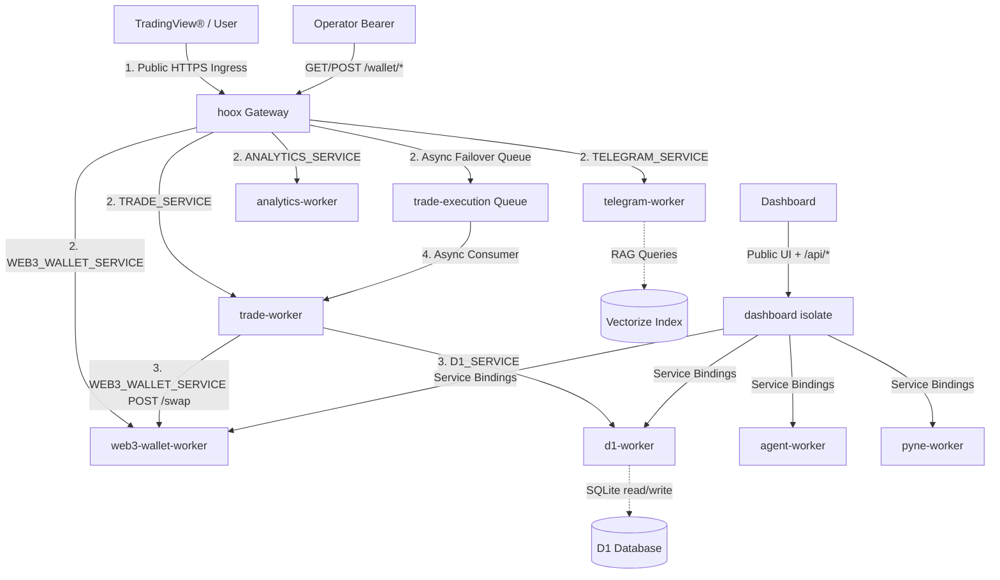

<!--
  Copyright (c) 2026 HOOX · jango-blockchained (hoox-sh)
  SPDX-License-Identifier: CC-BY-4.0
-->

---
title: "Internal Endpoints Map"
description: "Architectural routing flow and service-binding topology for the Hoox microservice mesh, with the canonical endpoint directory living under the API reference."
---

> **This document is now a stub focused on the routing flow. For complete endpoint specifications, see [`/docs/devops/api/endpoints`](/docs/devops/api/endpoints).**

This page captures the **architectural context** for routing across the Hoox microservice monorepo — the Mermaid routing diagram, the internal-auth header contract, and the request-trace propagation story. The exhaustive endpoint directory (per-worker route tables, JSON payloads, and success-response examples) lives in the canonical reference.

---

## 🏗️ Interactive Compute & Routing Flow

Public HTTPS hits the **hoox gateway** (webhooks, health, operator `/v1/*` and `/wallet/*`) or the **dashboard**. Mesh isolates stay private:



Operator `/wallet/*` is an explicit allowlist proxy (not a catch-all). Paths: `/`, `/status`, `/config`, `/balance`, `/transfer`, `/approve`, `/quote`, `/swap`, `/transactions`. Auth is Bearer `OPERATOR_API_KEY`; the gateway injects mesh `X-Internal-Auth-Key`.

---

## 🔐 Internal Authorization Contract

Every internal HTTP request between V8 isolates **must** transmit the standard bearer header:

```http
X-Internal-Auth-Key: <INTERNAL_KEY_BINDING>
```

This shared secret is provisioned per-worker as an encrypted `wrangler secret` and validated by `requireInternalAuth` / `authenticatedServiceFetch`. Scoped keys (`WALLET_EXECUTE_KEY_BINDING`, `TRADE_EXECUTE_KEY_BINDING`, D1 read/write keys) are preferred when set.

Public surfaces use different auth: webhook body `apiKey`, operator Bearer on `/v1/*` and `/wallet/*`, dashboard session cookies, pyne `X-API-Key`. See [`/docs/devops/api/endpoints`](/docs/devops/api/endpoints) for the full matrix.

---

## 🛰️ Request-Trace Propagation

<Tip>
  Every internal-to-internal transaction automatically inherits the `requestId`
  trace UUID generated by the gateway. This trace ID is attached as the
  `X-Request-Id` header, allowing you to trace a single webhook alert across D1
  database writes, R2 log outputs, and Telegram alerts instantly!
</Tip>

---

### 🔗 Next Steps

- **[Complete API Reference](/docs/devops/api/endpoints)** — The canonical endpoint directory with full request/response examples for every worker.
- **[Service Binding Mesh](/docs/devops/architecture/communication)** — Deep dive into the Zero-Trust service-binding topology and the public/internal isolation boundary.
- **[System Storage Architecture](/docs/devops/architecture/storage)** — Review R2 log offloading, D1 SQLite ledger layout, and Vectorize RAG indexes.
