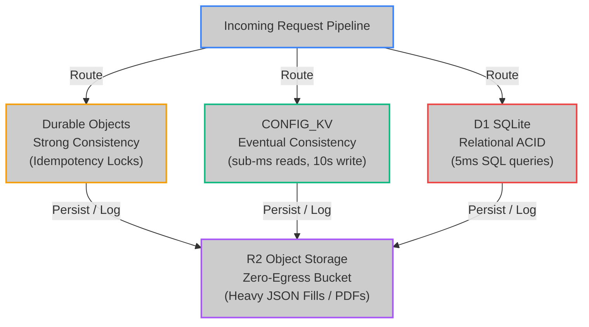

<!--
  Copyright (c) 2026 HOOX · jango-blockchained (hoox-sh)
  SPDX-License-Identifier: CC-BY-4.0
-->

---
title: "Storage & Data Engineering Spec"
description: "High-integrity architecture specifications for edge SQLite D1 databases, zero-egress R2 object stores, and eventually consistent KV cache namespaces."
---

Hoox operates a **multi-tier edge storage topology** to balance high-speed read/write performance, relational transactional safety, and long-term analytical capacity. By separating high-frequency dynamic states from static parameters and verbose event logs, Hoox ensures that latency remains in the single-digit milliseconds while keeping storage costs at $0/month.

---

## 1. The Multi-Tier Storage Architecture

Hoox segregates data into four distinct edge storage tiers based on consistency, read/write latency, and size constraints:



| Storage primitive   | Engine Technology   | Consistency Model    | Read Latency | Write Latency | Ideal Use Case                                               |
| :------------------ | :------------------ | :------------------- | :----------: | :-----------: | :----------------------------------------------------------- |
| **Durable Objects** | In-Memory Mutex     | Strong Consistency   |  **< 2ms**   |   **< 5ms**   | Atomic transaction locks, high-frequency concurrency dedup.  |
| **Workers KV**      | Distributed Cache   | Eventual Consistency |  **< 1ms**   |   **< 10s**   | Dynamic exchange routing paths, emergency Kill Switch.       |
| **D1 Database**     | Edge SQLite Isolate | Relational ACID      |  **< 5ms**   |  **< 12ms**   | Fills ledger, open positions matrix, margin balance records. |
| **R2 Storage**      | S3 Object Bucket    | Strong (per-object)  |  **< 35ms**  |  **< 50ms**   | Verbose exchange API request/response JSONs, PDF reports.    |

---

## 2. D1 relational engine and schema.sql

D1 runs a serverless SQLite engine in the Cloudflare Worker isolate. That removes a TCP handshake when executing SQL.

Canonical DDL lives at `workers/trade-worker/schema.sql` (`CREATE TABLE IF NOT EXISTS`). Apply it with `hoox db apply`; add tracking columns with `hoox db migrate` (`scripts/migrate-tracking.sh`). Full column list: [Database operations](/docs/enduser/guides/database-ops).

```sql
CREATE TABLE IF NOT EXISTS trades (
  id TEXT PRIMARY KEY,
  signal_id TEXT,
  timestamp INTEGER NOT NULL,
  exchange TEXT NOT NULL,   -- binance|bybit|mexc|uniswap-ethereum|uniswap-arbitrum|jupiter-solana
  symbol TEXT NOT NULL,
  action TEXT NOT NULL,     -- LONG | SHORT | CLOSE_LONG | CLOSE_SHORT
  quantity REAL,
  price REAL,
  leverage INTEGER,
  status TEXT NOT NULL,     -- EXECUTED | TEST_EXECUTED | FAILED | PENDING
  error_message TEXT,
  raw_response TEXT,
  tenant_id TEXT NOT NULL DEFAULT '',
  created_at INTEGER DEFAULT (unixepoch())
);

CREATE TABLE IF NOT EXISTS positions (
  id TEXT PRIMARY KEY,
  exchange TEXT NOT NULL,
  symbol TEXT NOT NULL,
  side TEXT NOT NULL,       -- LONG or SHORT
  entry_price REAL,
  size REAL,
  leverage INTEGER,
  status TEXT NOT NULL,     -- OPEN or CLOSED
  tenant_id TEXT NOT NULL DEFAULT '',
  updated_at INTEGER DEFAULT (unixepoch())
);
```

---

## 3. R2 log offloading

SQLite engines are single-writer databases. If write concurrency is too high, transaction queues can lock the thread. To conserve D1 write limits and maintain high performance during high-frequency events:

1. **D1 relational logs**: Only high-value financial transactions (the structured fields in the `trades` table above) are written to D1. **d1-worker** owns the `trade-data-db` binding; **trade-worker** reaches it over `D1_SERVICE`. **web3-wallet-worker** keeps a separate `TRANSACTIONS_DB` (`web3-wallet-transactions`) for on-chain tx records.
2. **R2 verbose blobs**: Full JSON payload exchanges, network headers, and stream records are serialized and saved to **R2 Storage** using date-based key paths:
   `logs/bybit/BTCUSDT/2026-05-19/order-18049284739.json`

This offloading strategy reduces D1 SQLite write volumes, keeping the database compact and within free-tier limits.

---

## 4. KV eventual consistency

Cloudflare KV is a highly distributed key-value store optimized for high-read/low-write operations:

- **Eventual consistency**: When you toggle a setting in KV (e.g. `trade:kill_switch = true`), the change is instantly cached at your local gateway node. However, it takes up to **10 seconds** to propagate to Cloudflare’s other 330+ locations globally.
- **Operational rule**: KV is perfect for global configurations, allowlists, and emergency kill switches. It is **never** used to track highly dynamic real-time states like position sizes, account drawdowns, or margin balances. High-frequency states must always be routed through D1 or Durable Objects.
- **Tenant keys**: When `TENANT_MODE` is on, helpers prefix KV/DO names `t/<id>/…` and R2 keys `t-<id>/…`. Off by default (identity).

---

<Warning>
  Back up production D1 before applying schema changes (`hoox db export --remote`).
  Then run `hoox db apply --remote` and `hoox db migrate --remote`.
</Warning>

### Next steps

- **[Internal Endpoints Mapping](/docs/devops/architecture/endpoints)** — Map out exposed ports, URLs, and service bindings.
- **[Wrangler Setup & Tooling](/docs/devops/development/local-dev)** — Configure Wrangler to bind local D1 and KV instances for dev testing.
