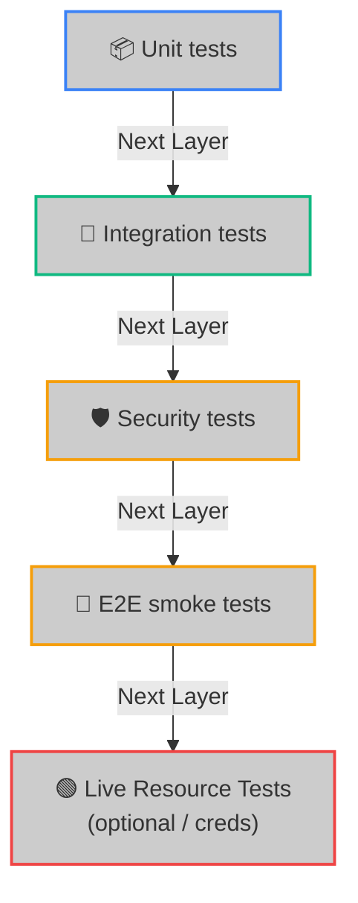

<!--
  Copyright (c) 2026 HOOX · jango-blockchained (hoox-sh)
  SPDX-License-Identifier: CC-BY-4.0
-->

---
title: "Testing Framework & QA Standards"
description: "Detailed QA operations guide, covering Bun test suites, Miniflare integration testing, E2E cli lifecycles, and live Cloudflare resource audits."
---

To protect live capital and ensure robust order routing, Hoox mandates a rigorous testing pipeline. With money on the line, we verify every contract calculation, rate-limiting gate, and database query.

The suite runs on **Bun's test runner** across the CLI, the shared package, the TUI, the workers, and the dashboard. Counts move with the tree. A printed total such as "~4,600 tests" or "~9,300 assertions" is not a contract — the CI job that runs CLI, shared, and worker packages is a different set from a full local `bun test`.

---

## 🎚️ The 5 QA Testing Layers



---

## ⚡ Running Tests: CLI Commands

Day-to-day, use **Bun** from the monorepo root. The Hoox CLI wraps the same suites.

### A. Core Platform Verification (Excluding Live)

```bash
# 1. Run unit tests (excludes tests/live and packages/tui; then runs test:tui)
bun test

# 2. Coverage for a package
bun test --coverage
bun test packages/cli/ --coverage

# 3. CLI wrappers
hoox test unit
hoox test all            # lint → typecheck → unit → integration
hoox test worker trade-worker
hoox test live           # needs tests/live/.env
```

### B. Workspace-Specific Targeted Runs

Root `package.json` scripts:

```bash
bun run test:cli         # packages/cli/
bun run test:tui         # packages/tui/ (preload test-setup)
bun run test:shared      # packages/shared/
bun run test:workers     # workers/*
bun run test:trade-worker
bun run test:integration # tests/integration/
bun run test:e2e         # tests/e2e/
bun run test:security    # tests/security/
bun run test:live        # tests/live/ --jobs 1
bun run test:load        # k6 (requires k6 CLI)
bun run test:all         # lint && typecheck && test && test:live

# Single file with watch
bun test workers/agent-worker/src/index.test.ts --watch
```

### C. Security & Fuzz Testing

```bash
# Run all security tests (auth bypass, security headers, fuzz)
bun run test:security

# Run specific security test files
bun test tests/security/auth-bypass.test.ts
bun test tests/security/security-headers.test.ts
bun test tests/security/fuzz.test.ts
```

### D. Advanced Integration & Live Runs

```bash
# Gateway / mesh integration tests
bun run test:integration
hoox test integration    # CLI wrapper; prefer `bun run test:integration`

# E2E CLI lifecycle smoke tests
bun run test:e2e

# Live Cloudflare API tests (requires tests/live/.env credentials)
bun run test:live
hoox test live --service d1

# k6 performance/load tests (requires k6 CLI)
bun run test:load
```

---

## 🔒 Type-Safe Mocking Specifications (No `as any`)

To enforce strict TypeScript compiler safety, test files **must never** utilize `as any` to bypass types when mock-binding resources. Always cast stubs using `as unknown as Env`:

```typescript
import { describe, it, expect } from "bun:test";
import type { Env } from "../src/index";

describe("trade-worker Gateway Router Mocking", () => {
  it("should securely mock internal service binding fetchers", async () => {
    // 1. Construct a type-safe mock environment structure
    const mockEnv = {
      INTERNAL_KEY_BINDING: "local_secret_token_183",
      TELEGRAM_SERVICE: {
        fetch: async (url: string, init?: RequestInit) => {
          // Verify auth headers exist
          const headers = init?.headers as Record<string, string>;
          if (headers["X-Internal-Auth-Key"] !== "local_secret_token_183") {
            return new Response(JSON.stringify({ success: false }), {
              status: 401,
            });
          }

          return new Response(
            JSON.stringify({
              success: true,
              messageId: 4829,
            }),
            { status: 200 }
          );
        },
      } as Fetcher,
    } as unknown as Env;

    // 2. Execute assertions
    const res = await mockEnv.TELEGRAM_SERVICE.fetch(
      "https://telegram-worker/alert",
      {
        method: "POST",
        headers: {
          "X-Internal-Auth-Key": "local_secret_token_183",
        },
      }
    );

    const data = await res.json();
    expect(res.status).toBe(200);
    expect(data.success).toBe(true);
    expect(data.messageId).toBe(4829);
  });
});
```

---

## 🚢 Continuous Integration Gates & Coverage Targets

Our GitHub Actions workflows enforce the following quality gates:

1. **TypeScript Type Safety**: All workspaces must compile without errors using `tsc --noEmit`.
2. **Coverage Thresholds**: CI and contributor standards target **≥80% line coverage** on core execution paths (`packages/cli`, `packages/shared`, gateway/trade workers), with aspirational **90% line / 95% function** floors in `.opencode/context/core/standards/test-coverage.md`. Shared is already ~98%; CLI `src/` averages ~95%. Per-file CLI floor: `bun run coverage:check` (50% hard floor on `packages/cli/src/**`, ratcheting upward).
3. **Dependency Audit**: `bun audit` runs after tests to detect known vulnerabilities (informational, doesn't block CI).
4. **Secret Scanning**: `gitleaks` scans all commits for hardcoded secrets on every push/PR (informational).
5. **CodeQL**: Weekly `security-and-quality` analysis for JavaScript/TypeScript.

```bash
# Check your local workspace coverage statistics
bun test packages/cli/ --coverage
bun test packages/shared/ --coverage
bun run coverage:check   # CLI per-file floor (needs lcov from a coverage run)
```

### 🔗 Next Steps

- **[Security Testing & Hardening](/docs/devops/security/overview)** — Auth hardening, security tests, and CI/CD scanning.
- **[Debugging Telemetry Runbook](/docs/devops/development/debugging)** — Learn how to trace active V8 memory, tail logs, and audit SQL execution.
- **[Local Development Setup](/docs/devops/development/local-dev)** — Configure Wrangler and Docker compose to run testbeds.
