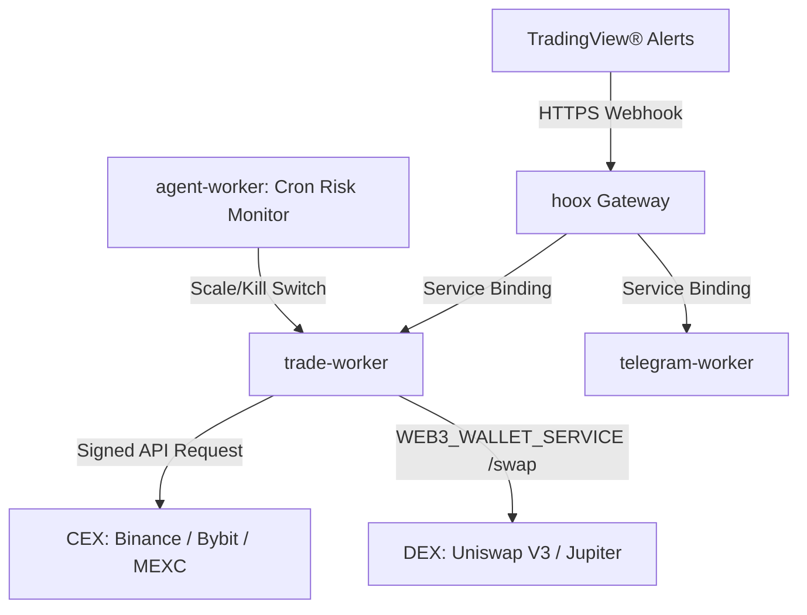

<!--
  Copyright (c) 2026 HOOX · jango-blockchained (hoox-sh)
  SPDX-License-Identifier: CC-BY-4.0
-->

---
title: "📚 Hoox Developer Hub"
description: "Edge-Native Algorithmic Trading on the Cloudflare® Edge"
---

> **Hoox** is a free, open-source, edge-native algorithmic trading framework and automation engine deployed natively to the **Cloudflare® Edge Network**. By utilizing a distributed microservice architecture, Hoox processes trade signals, evaluates risk parameters, executes order routing, and fires Telegram notifications—all within milliseconds and directly from the edge nodes closest to exchange servers.

Install with `bun add -g @hoox-sh/hoox-cli`, then `hoox onboard` (alias `hx`).

---

## 🗺️ Choose Your Path

Whether you are a retail algorithmic trader setting up your first automated TradingView® strategies or a quantitative analyst wiring webhooks, this **End User** tab covers trader-facing setup and operations.

Platform design lives under **Architecture** and **Workers**; install/deploy under **DevOps**; HTTP contracts under **API**.

### 1. 🏁 Getting Started

If you are brand new to the Hoox ecosystem, start here to prepare your machine, provision resources, and deploy your first live microservice in under 5 minutes:

- **[Core Installation](/docs/enduser/getting-started/installation)** — Install `@hoox-sh/hoox-cli`, clone the monorepo, and run `hoox onboard`.
- **[Platform Configuration](/docs/enduser/getting-started/configuration)** — Declaratively define environment variables, JSON profile templates, and KV keys.
- **[5-Minute Quick Start](/docs/enduser/getting-started/quick-start)** — Launch local worker runners and execute a simulated webhook trade signal.

### 2. 🧠 Core Concepts

Understand the underlying technology, low-latency edge architecture, and security layers that protect your api keys:

- **[Product ecosystem](/docs/enduser/concepts/ecosystem)** — HOOX vs PYNE vs AXIS vs PyneTS vs pyne-worker.
- **[How Hoox Works](/docs/enduser/concepts/how-hoox-works)** — The end-to-end lifecycle of a trade signal from webhook alert to order confirmation.
- **[Edge-First Architecture](/docs/enduser/concepts/edge-architecture)** — Why V8 isolates and Cloudflare® Workers outperform traditional VPS architectures by 30-60%.
- **[Cloudflare® Services Map](/docs/enduser/concepts/cloudflare-services)** — How D1, KV, R2, Queues, Vectorize, and Browser Rendering are integrated.
- **[Idempotency & Durable Objects](/docs/enduser/concepts/idempotency)** — Two-phase reserve/commit/release, fail-closed missing DO, and rate-limit Durable Objects.
- **[Signals & Trade Routing](/docs/enduser/concepts/signals-and-trades)** — How parameters map from webhook JSON schemas to live exchange payloads.
- **[AI Risk Manager](/docs/enduser/concepts/ai-risk-manager)** — The configurable-cron autonomous risk scanner (1–1440 min), trailing-stop mathematician, and account kill-switch.

### 3. 🛠️ Operational Guides

Practical runbooks and blueprints for daily operations, local development, and system health maintenance:

- **[Local Dev & Workspaces](/docs/enduser/guides/local-development)** — Run, hot-reload, and test workers locally via Bun or Docker container stacks.
- **[Terminal UI Operations](/docs/enduser/guides/tui)** — Launch and navigate the full-screen operations cockpit (`hoox tui` / `@hoox-sh/hoox-tui`).
- **[Interface gallery](/docs/enduser/guides/screenshots)** — Screenshots and GIFs of the CLI, TUI, and dashboard.
- **[Edge Database Operations](/docs/enduser/guides/database-ops)** — Apply `schema.sql`, run tracking migrations, and query D1.
- **[Secrets & Network Security](/docs/enduser/guides/secrets-security)** — Secure Cloudflare® Zero Trust corridors and encrypt sensitive API credentials.
- **[Test Trading](/docs/enduser/guides/test-trading)** — Sandbox orders with `"test": true`, dedicated testnet secrets, and D1/dashboard isolation.
- **[DEX spot swaps](/docs/enduser/guides/dex-spot-swaps)** — Uniswap V3 and Jupiter Swap V2 via `BASE/QUOTE` signals.
- **[Infrastructure Management](/docs/enduser/guides/manage-infra)** — Spin up and inspect KV, Queues, R2, and Vectorize indexes in one command.
- **[Deploying to Production](/docs/enduser/guides/deploy-workers)** — Roll out code, bind V8 isolates, and deploy Next.js dashboard consoles.
- **[Self-Healing & Repair](/docs/enduser/guides/repair)** — Diagnose connection dropouts, rotate API keys, and run interactive system repair tools.
- **[PYNE live trading](/docs/enduser/guides/pyne-live-trading)** — Bar-close cron: strategy events → trade-worker. Alerts are a separate webhook.
- **[AXIS and HOOX](/docs/enduser/guides/axis-and-hoox)** — The chart evaluates. The mesh executes. They do not share an order router.

### 4. 🎓 Step-by-Step Tutorials

Follow guided, end-to-end tutorials to integrate your trade sources and notification handlers:

- **[TradingView® Webhook Integration](/docs/enduser/tutorials/tradingview-webhook)** — Write customized Pine Script™ v6 indicators that ping the Hoox webhook receiver.
- **[Telegram Bot Setup](/docs/enduser/tutorials/telegram-bot)** — Configure real-time order alerts, P&L reports, and secure chat commands.
- **[Email Signal Routing](/docs/enduser/tutorials/email-signals)** — Mailgun webhook, Cloudflare® Email Routing, or authenticated JSON. No IMAP poll.

### 5. 📖 Reference Material

Deep specifications, schema registries, and command-line manual trees:

- **[CLI Commands Index](/docs/enduser/reference/cli-commands)** — Complete options, positional arguments, and JSON flag trees for the `hoox` tool.
- **[API Spec & REST Routes](/docs/enduser/reference/api-endpoints)** — HTTP endpoints, request payloads, response templates, and edge errors list.
- **[Configuration Properties](/docs/enduser/getting-started/configuration)** — Environment variables and CONFIG_KV keys.
- **[MCP server](/docs/devops/mcp)** — Drive every `hoox` command from an MCP client (`bun run mcp`). Confirm gate on mutations.

---

## 📥 Offline Reference & AI Context

Consolidated specifications and LLM context packages are available in the [GitHub repository](https://github.com/hoox-sh/hoox).

---

<Tip>
  Looking for deep engineering plans, DDL SQL schemas, or CI/CD deployment
  workflows? Check out the **[DevOps & Architecture Manual](/docs/devops/index)**
  for developer-centric operator blueprints!
</Tip>
